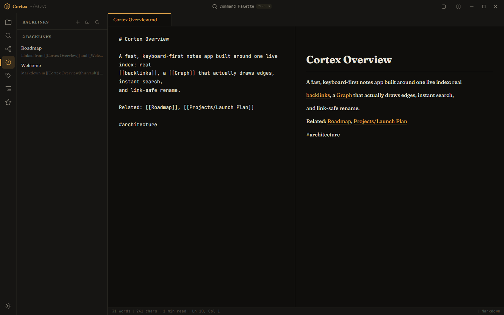
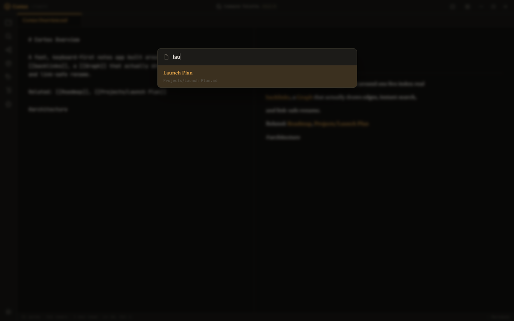
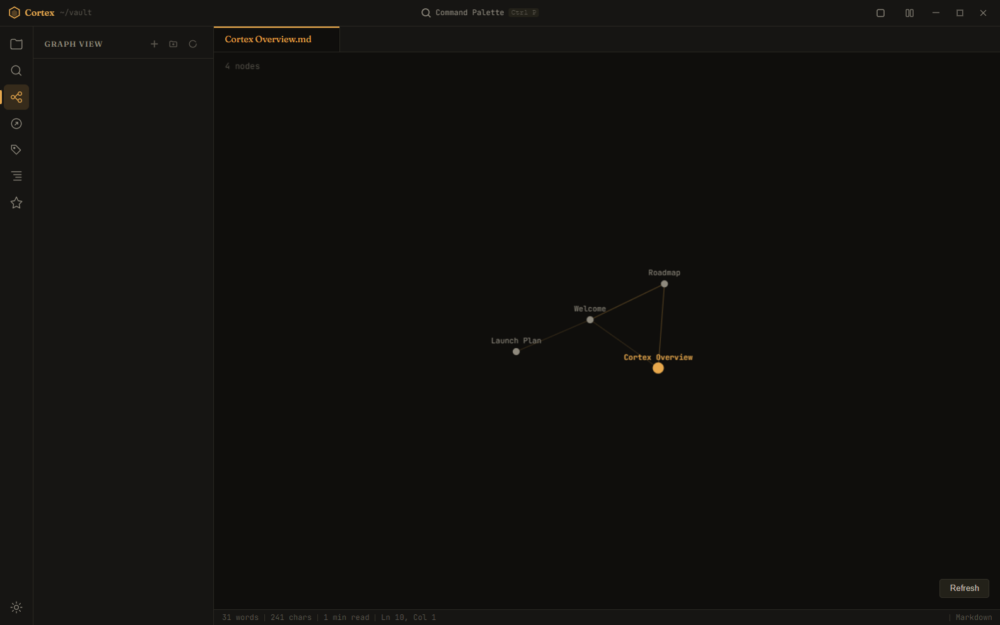

<div align="center">


# Cortex

**A local-first second brain that never leaves your disk.**

Plain Markdown files. One live index. No account, no cloud, no lock-in.

[](LICENSE)
[](#)
[](#)
[](#testing)

</div>

<p align="center">
  
</p>

Cortex is a keyboard-first notes app for people who want their second brain to
be a folder of `.md` files they actually own — not a database behind someone
else's API. Open it, start typing, and everything you write is there on disk,
in a format every other editor on earth can read.

## Why Cortex

Most "Markdown knowledge base" apps either re-scan your whole vault on every
keystroke, or keep a database you can't inspect. Cortex does neither: the
main process keeps **one in-memory index**, fed live by a filesystem watcher,
and every panel — backlinks, tags, graph, search — reads from it instead of
walking your folders. The result is a notes app that stays fast as your vault
grows, and a rename that actually rewrites every `[[wikilink]]` that pointed
at the old name.

## Features

**The engine**
- 🔗 **Real backlinks** — not a text search over file names, actual resolved links, with the line that links to you
- 🕸️ **A graph that draws edges** — click a node to open it, watch it settle
- 🔍 **Instant full-text search** — ranked by title, heading, then body
- ✏️ **Link-safe rename** — rename a note and every `[[link]]` to it is rewritten, across the whole vault, atomically
- 🌍 **Unicode-aware** — `Çalışma` and `çalışma` resolve to the same note; non-ASCII tags and names just work

**The daily loop**
- ⌨️ **Quick switcher** (`Ctrl+O`) — fuzzy-find any note by name, recents first
  <br>
- ⚡ **Quick capture** (`Ctrl+Shift+N`) — drop a timestamped thought into today's daily note without leaving what you're writing
- 📑 **Outline panel** — every heading in the open note, click to jump
- 🧩 **Unlinked mentions** — Cortex notices when you've typed a note's name without linking it, and turns it into a link in one click
- 🪟 **Workspace restore** — your open tabs, the active one, your side panel and layout come back exactly as you left them, per vault

**Safety, by construction**
- A create or rename can never silently overwrite an existing note
- A save that fails stays visibly dirty — nothing is lost quietly
- The whole filesystem surface is confined to the vault root and goes through one audited module
- 143 unit tests and 24 end-to-end scenarios run against a throwaway vault, never your real one

<p align="center">
  
</p>

## Getting started

```bash
git clone https://github.com/mikeperac-cyber/cortex.git
cd cortex
npm install
npm start
```

Your vault lives at `~/Documents/CortexVault` by default (created on first
run). Open the command palette with `Ctrl+P`, or just start typing.

### Keyboard shortcuts

| Shortcut | Action |
|---|---|
| `Ctrl+P` | Command palette |
| `Ctrl+O` | Quick switcher — jump to any note |
| `Ctrl+Shift+N` | Quick capture — one line into today's daily note |
| `Ctrl+N` | New note |
| `Ctrl+S` | Save |
| `Ctrl+W` | Close tab |
| `Ctrl+E` | Toggle preview |
| `Ctrl+G` | Graph view |
| `Ctrl+Shift+F` | Search |
| `F11` | Focus mode |

### Building a portable `.exe`

```bash
npm run build
```

Produces `dist/Cortex 1.0.0.exe`, a single-file portable build — no
installer, no admin rights, just run it.

## Testing

```bash
npm test          # unit tests (node:test) — needs Node 21+
npm run test:e2e  # end-to-end scenarios, one Electron window each
```

Every e2e scenario seeds a temp vault and tears it down afterward; none of
them ever touch your real notes.

## How it's built

- **Main process** owns the filesystem, confined to the vault root, and a
  single `VaultIndex` kept current by `fs.watch` — notes, resolved links,
  tags, graph edges and search are all computed once per change, not once
  per panel open.
- **Renderer** is plain JS loaded as classic `<script>` tags: no bundler, no
  build step for development. Shared pure logic (parsing, fuzzy ranking,
  link rewriting) lives in `src/lib/` and is unit-tested directly in Node.
- Every feature shipped behind a **task-by-task review with its own tests**
  before merging — the engineering notes are in
  [`docs/superpowers/plans/`](docs/superpowers/plans) if you want to see how.

## Project status

Cortex is an early-stage personal project, Windows-only for now (it leans on
`fs.watch`'s recursive mode, which Windows and macOS support but Linux
doesn't yet). The five plugins bundled in the sidebar — TaskFlow, DailySync,
Recall, DataForge, FocusPulse — are a work in progress and not yet at the
quality of the core notes engine above; a dedicated pass to make them real is
next on the roadmap. No code signing or auto-update yet either. Expect rough
edges, and issues are welcome.

## License

[MIT](LICENSE)
